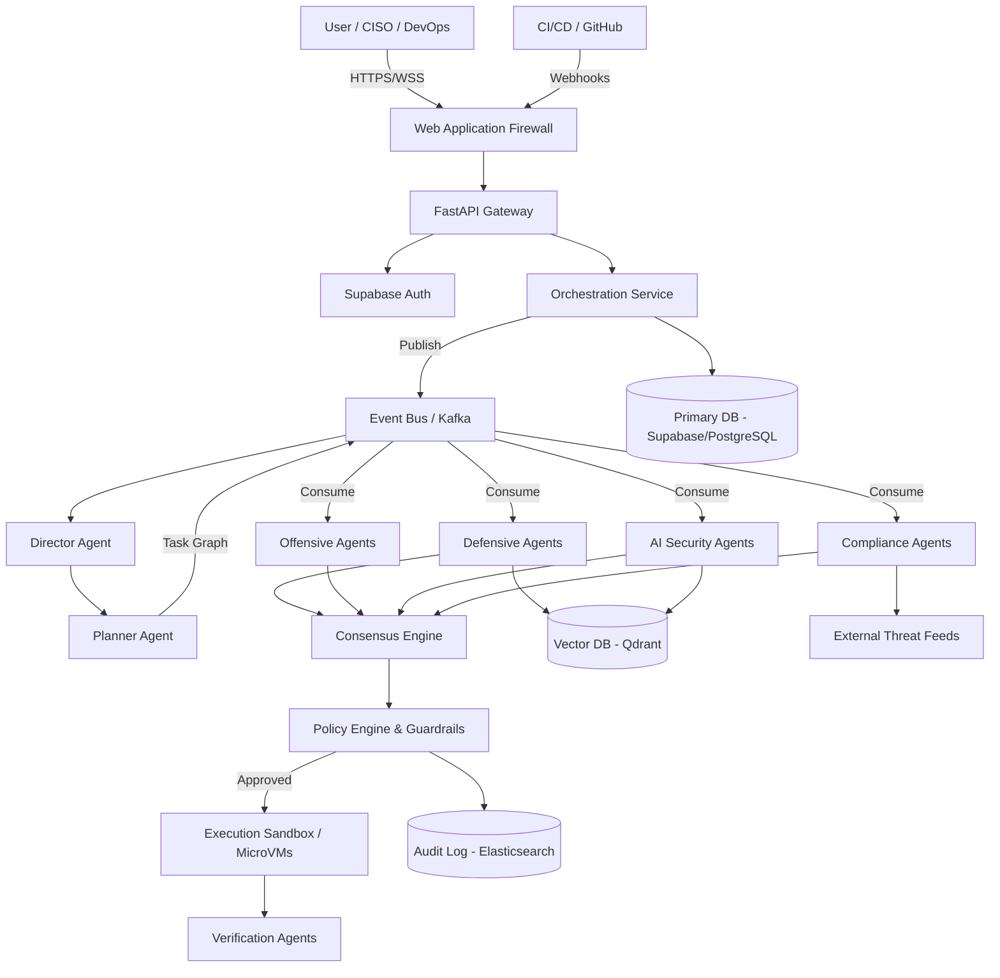

# SentinelAI: Technical Architecture Document

## System Overview
SentinelAI is an enterprise-grade Agentic AI Security Operating System. Unlike traditional, monolithic security scanners, SentinelAI is built around a distributed, highly scalable multi-agent ecosystem. It orchestrates dozens of specialized AI agents (Offensive, Defensive, AI Security, Compliance, Threat Intelligence, and Verification) to autonomously perform secure software analysis, remediation planning, and continuous validation. The system emphasizes defense-in-depth, least-privilege principles, and a robust consensus-driven verification engine to ensure all operations are accurate and secure.

## High-Level Architecture
The SentinelAI architecture is built on a modern, event-driven, cloud-native paradigm. It consists of the following primary tiers:
1.  **Presentation Layer (Frontend):** A React-based web application providing dashboards, reporting, and management interfaces for CISOs, Security Engineers, and DevOps leads.
2.  **API Gateway & Orchestration Layer (Backend):** A high-performance FastAPI Python application handling routing, authentication, and rate limiting. Behind it lies the Agent Orchestrator, which acts as the central brain routing tasks to various agent swarms.
3.  **Agent Ecosystem (AI/Agent Layer):** A distributed network of AI agents (Python/LangChain) operating in isolated sandboxes. This layer includes the Director, Planner, and various specialized agents (SAST, DAST, Secret Detection, Jailbreak Detection, etc.).
4.  **Data & Persistence Layer (Database):** A polyglot persistence architecture utilizing relational databases for structured data, vector databases for semantic memory, and document stores for unstructured reports and logs.
5.  **Execution Sandbox (Infrastructure):** Ephemeral, secure environments (e.g., gVisor, Firecracker microVMs) where agents execute code, validate exploits, and perform potentially dangerous operations.

## Architecture Diagram

## Low-Level Architecture
At the micro-level, every agent is treated as an independent microservice or serverless function wrapped in a strict proxy. When the Planner Agent decomposes a task (e.g., "Scan repo for vulnerabilities"), it places sub-tasks onto specific Kafka topics. Specialized agents consume these tasks, execute their logic using foundation models (via a centralized LLM routing gateway), and publish findings back to the Event Bus. The Consensus Engine aggregates these findings, runs peer-review validation, and finally requests the PR Review Agent to create a remediation.

## Component Breakdown
1.  **API Gateway:** FastAPI with Uvicorn/Gunicorn. Handles JWT validation (Supabase JWTs), rate limiting, and request routing.
2.  **Auth Service:** **Supabase Auth** — managed OAuth2/OIDC service with support for Email/Password, Magic Link, SSO (GitHub, Google, Microsoft), MFA (TOTP), and built-in Row-Level Security (RLS) on the database layer.
3.  **Agent Orchestrator:** The core workflow engine managing state transitions of the task graph.
4.  **Director Agent:** The primary entry point for complex requests, responsible for high-level reasoning.
5.  **Consensus Engine:** A statistical and logic-based engine that aggregates findings from multiple agents to reduce false positives.
6.  **Policy Engine:** Enforces guardrails (e.g., preventing unauthorized tool usage, blocking cross-tenant memory access).

## Frontend Architecture
-   **Framework:** Next.js (React) using Server-Side Rendering (SSR).
-   **State Management:** Zustand for global state, React Query for server state.
-   **UI Library:** Tailwind CSS with shadcn/ui.
-   **Real-time:** WebSockets for live agent execution tracing.

## Backend Architecture
-   **Core Services:** Python (FastAPI) for high-concurrency orchestration, API routing, and event processing.
-   **Agent Framework:** Python (LangChain/LlamaIndex) for agent logic, prompt construction, and LLM interaction.
-   **Event Streaming:** Apache Kafka for high-throughput, asynchronous communication between agents.
-   **API Protocols:** REST for CRUD operations, gRPC for internal service-to-service communication, WebSockets for frontend streaming.

## Database Architecture
-   **Primary Relational DB:** PostgreSQL. Stores users, roles, projects, task metadata, and structured findings.
-   **Vector Database:** Qdrant or Milvus. Stores semantic embeddings of codebases, threat intelligence, and long-term project memory for RAG.
-   **Document Store:** MongoDB or DynamoDB. Stores raw LLM responses, generated reports, and complex JSON schemas.
-   **Cache:** Redis. Used for session management, rate limiting, and caching LLM prompt results.

## AI Architecture
-   **LLM Gateway:** A centralized proxy (e.g., LiteLLM) that routes requests to various foundation models (OpenAI GPT-4, Anthropic Claude 3, local Llama 3).
-   **RAG Pipeline:** Utilizes the Vector DB for retrieving context before prompting the agent.
-   **Evaluation Pipeline:** Asynchronous background jobs that benchmark agent responses against predefined ground truths.

## Agent Architecture
Each agent follows a strict internal loop:
1.  **Observe:** Read task from Kafka topic.
2.  **Retrieve Context:** Query Vector DB for relevant memory.
3.  **Reason:** Query LLM for next steps.
4.  **Act (Tool Use):** Request tool invocation.
5.  **Validate:** Intercepted by Tool Permission Agent and Policy Engine.
6.  **Synthesize:** Formulate final finding and publish to event bus.

## API Flow
1.  Client POSTs a request to `/api/v1/scans`.
2.  FastAPI Gateway validates JWT and forwards to Orchestrator.
3.  Orchestrator creates a Scan ID, writes to PostgreSQL, and pushes an event to Kafka.
4.  API returns `202 Accepted` with the Scan ID.
5.  Client polls `/api/v1/scans/{id}` or listens via WebSocket for updates.

## Event Flow
1.  Director Agent publishes `TaskCreated` event.
2.  Planner Agent consumes, decomposes, and publishes multiple `SubTaskCreated` events.
3.  Specialized Agents consume their sub-tasks and publish `FindingGenerated` events.
4.  Consensus Engine consumes findings, runs peer review, and publishes `ConsensusReached`.
5.  Report Generator consumes consensus, generates final PDF/Markdown, and publishes `ReportReady`.

## Authentication Flow
-   **Supabase Auth** is the primary identity layer.
-   Supports: Email/Password, Magic Link, OAuth Providers (GitHub, Google, Microsoft/Entra ID), and SAML 2.0 for enterprise SSO.
-   Issues short-lived JWTs (Access Tokens, 1-hour expiry) with HTTP-only Refresh Tokens managed automatically by the Supabase client SDK.
-   JWT claims include `sub` (user UUID), `role`, `email`, and custom `app_metadata` claims (e.g., `tenant_id`, `role`).
-   Machine-to-Machine (M2M) authentication uses Supabase Service Role Key with mutual TLS for internal backend services.

## Authorization Flow
-   **RBAC:** Roles are stored in Supabase's `app_metadata` JWT claim: `Viewer`, `Engineer`, `CISO`, `Superadmin`.
-   **Row-Level Security (RLS):** Supabase RLS policies enforce tenant isolation at the database level — users can only SELECT/INSERT/UPDATE rows where `tenant_id` matches their JWT claim. No application-layer filtering required.
-   **Superadmin Gating:** Specific features (e.g., the *Exploit Generation Module*) require a `Superadmin` role claim. Enforced at both the API Gateway (`/api/v1/exploits/generate`) and via Supabase RLS policies on restricted tables.
-   **ABAC:** Attribute-based access control is layered on top via custom Supabase RLS policies and Python service-layer checks.

## Deployment Architecture
-   **Cloud-Native:** Deployed on Kubernetes (EKS/GKE).
-   **IaC:** Infrastructure provisioned using Terraform.

## Tech Stack Justification
-   **Python (FastAPI):** Unifies the backend and AI logic under a single language ecosystem, maximizing developer velocity and native integration with AI libraries.
-   **Next.js (Frontend):** Excellent for building performant dashboards.
-   **Kafka (Event Bus):** Proven durability and throughput.
-   **Supabase (PostgreSQL + Auth + RLS):** Replaces standalone PostgreSQL and a custom auth service. Provides managed Postgres, built-in JWT-based auth, Row-Level Security, and Realtime subscriptions out of the box — dramatically reducing infrastructure overhead.
-   **Qdrant:** High-performance vector similarity search for RAG pipelines and agent semantic memory.
-   **Firecracker (Sandbox):** Rapid, secure exploit validation.
