# SentinelAI: Database Architecture Specification

## Overview
This document outlines the database architecture for SentinelAI. The primary relational database and authentication layer are powered by **Supabase** — a managed, open-source Firebase alternative built on top of PostgreSQL. Supabase provides ACID-compliant PostgreSQL storage, built-in JWT-based authentication, Row-Level Security (RLS) for tenant isolation, and Realtime subscriptions. Supplementary stores (Vector DB and Document/Log Store) remain specialized systems optimized for their respective workloads.

## Database Selection (Polyglot Persistence)
We adopt a polyglot persistence strategy to optimize for different access patterns:

1. **Primary Database:** **Supabase** (hosted PostgreSQL 15+). Handles Users, Tenants, Projects, Scans, Findings, Remediations, and RBAC. Supabase replaces both the standalone PostgreSQL instance and the custom Auth Service.
2. **Vector Database:** **Qdrant** (or Milvus). Chosen for high-performance similarity search. Stores codebase embeddings, threat intelligence (CVEs), and Agent Semantic Memory.
3. **Document / Log Store:** **Elasticsearch** (or OpenSearch). Chosen for full-text search and immutable audit trails of every agent action and tool invocation.
4. **Cache & Key-Value:** **Redis**. Used for rate limiting and caching LLM prompt responses. *Note: Session management is handled by Supabase Auth, so Redis is no longer used for sessions.*

---

## Supabase Project Setup

### Environment Variables (Frontend — Next.js)
```env
NEXT_PUBLIC_SUPABASE_URL=https://<your-project-ref>.supabase.co
NEXT_PUBLIC_SUPABASE_ANON_KEY=<your-anon-key>
```

### Environment Variables (Backend — FastAPI)
```env
SUPABASE_URL=https://<your-project-ref>.supabase.co
SUPABASE_SERVICE_ROLE_KEY=<your-service-role-key>
```

> **IMPORTANT:** The `service_role` key has full database access and bypasses RLS. It must NEVER be exposed to the frontend. Keep it server-side only.

---

## ER Diagram (Supabase / PostgreSQL Core)

```mermaid
erDiagram
    auth_users ||--o{ profiles : has
    profiles }o--|| tenants : belongs_to
    tenants ||--o{ projects : owns
    profiles ||--o{ scans : initiates
    projects ||--o{ scans : contains
    scans ||--o{ tasks : spawns
    tasks ||--o{ findings : generates
    findings ||--o{ remediations : has

    auth_users {
        uuid id PK
        string email
        timestamp created_at
    }
    profiles {
        uuid id PK
        uuid user_id FK
        uuid tenant_id FK
        string display_name
        string role
        timestamp created_at
    }
    tenants {
        uuid id PK
        string name
        string plan
        timestamp created_at
        timestamp deleted_at
    }
    projects {
        uuid id PK
        uuid tenant_id FK
        string name
        string repo_url
        timestamp created_at
    }
    scans {
        uuid id PK
        uuid project_id FK
        uuid user_id FK
        string status
        timestamp started_at
        timestamp completed_at
    }
    tasks {
        uuid id PK
        uuid scan_id FK
        string agent_type
        string status
        jsonb context
    }
    findings {
        uuid id PK
        uuid scan_id FK
        uuid task_id FK
        string severity
        string title
        text description
        string cwe_id
        boolean verified_by_consensus
        jsonb metadata
    }
    remediations {
        uuid id PK
        uuid finding_id FK
        text proposed_code_fix
        string pr_url
        string status
    }
```



---

## Tables (Supabase / PostgreSQL)

### Note on `auth.users`
Supabase maintains its own internal `auth.users` table. Application code **must not** write directly to `auth.users`. Instead, a `profiles` table is created as a public extension:

### Table: `profiles`
- `id` (UUID, PK) — Mirrors `auth.users.id`
- `user_id` (UUID, FK → `auth.users.id`) — Auth reference
- `tenant_id` (UUID, FK → `tenants.id`) — Multi-tenancy link
- `display_name` (VARCHAR 100)
- `role` (VARCHAR 50) — `Viewer`, `Engineer`, `CISO`, `Superadmin`
- `created_at` (TIMESTAMPTZ) — Default `NOW()`
- `updated_at` (TIMESTAMPTZ) — Updated via trigger
- `deleted_at` (TIMESTAMPTZ) — Soft delete

### Table: `tenants`
- `id` (UUID, PK)
- `name` (VARCHAR 200, UNIQUE)
- `plan` (VARCHAR 50) — `Free`, `Pro`, `Enterprise`
- `created_at` (TIMESTAMPTZ)
- `deleted_at` (TIMESTAMPTZ)

### Table: `projects`
- `id` (UUID, PK)
- `tenant_id` (UUID, FK → `tenants.id`)
- `name` (VARCHAR 200)
- `repo_url` (TEXT)
- `created_at` (TIMESTAMPTZ)

### Table: `scans`
- `id` (UUID, PK)
- `project_id` (UUID, FK → `projects.id`)
- `user_id` (UUID, FK → `auth.users.id`)
- `status` (VARCHAR 20) — `QUEUED`, `RUNNING`, `COMPLETED`, `FAILED`
- `scan_types` (TEXT[]) — e.g., `{"SAST","SCA","DAST"}`
- `started_at` (TIMESTAMPTZ)
- `completed_at` (TIMESTAMPTZ)

### Table: `tasks`
- `id` (UUID, PK)
- `scan_id` (UUID, FK → `scans.id`)
- `agent_type` (VARCHAR 50)
- `status` (VARCHAR 20)
- `context` (JSONB)

### Table: `findings`
- `id` (UUID, PK)
- `scan_id` (UUID, FK → `scans.id`)
- `task_id` (UUID, FK → `tasks.id`)
- `severity` (VARCHAR 20) — `CRITICAL`, `HIGH`, `MEDIUM`, `LOW`, `INFO`
- `title` (VARCHAR 255)
- `description` (TEXT)
- `cwe_id` (VARCHAR 50)
- `file_path` (VARCHAR 500)
- `line_number` (INTEGER)
- `verified_by_consensus` (BOOLEAN)
- `metadata` (JSONB)

### Table: `remediations`
- `id` (UUID, PK)
- `finding_id` (UUID, FK → `findings.id`)
- `proposed_code_fix` (TEXT)
- `pr_url` (TEXT)
- `status` (VARCHAR 50) — `PENDING`, `APPLIED`, `REJECTED`

---

## Row-Level Security (RLS) Policies

All tables have RLS **enabled by default**. This enforces tenant isolation and user permissions at the database layer.

### Example: `profiles` table
```sql
-- Enable RLS
ALTER TABLE profiles ENABLE ROW LEVEL SECURITY;

-- Users can only see their own profile
CREATE POLICY "Users can view own profile"
  ON profiles FOR SELECT
  USING (auth.uid() = user_id);

-- Users can update only their own profile
CREATE POLICY "Users can update own profile"
  ON profiles FOR UPDATE
  USING (auth.uid() = user_id);
```

### Example: `scans` table (tenant-scoped)
```sql
ALTER TABLE scans ENABLE ROW LEVEL SECURITY;

-- Users can only see scans belonging to their tenant
CREATE POLICY "Tenant isolation on scans"
  ON scans FOR SELECT
  USING (
    project_id IN (
      SELECT id FROM projects
      WHERE tenant_id = (
        SELECT tenant_id FROM profiles WHERE user_id = auth.uid()
      )
    )
  );
```

### Example: `findings` table (Superadmin-only write)
```sql
ALTER TABLE findings ENABLE ROW LEVEL SECURITY;

-- All users can read findings in their tenant
CREATE POLICY "Read findings in tenant"
  ON findings FOR SELECT
  USING (
    scan_id IN (
      SELECT id FROM scans WHERE project_id IN (
        SELECT id FROM projects WHERE tenant_id = (
          SELECT tenant_id FROM profiles WHERE user_id = auth.uid()
        )
      )
    )
  );

-- Only service_role (backend) can insert findings
CREATE POLICY "Backend inserts findings"
  ON findings FOR INSERT
  WITH CHECK (auth.role() = 'service_role');
```

---

## Supabase Authentication Configuration

### Enabled Providers
| Provider            | Purpose                            |
|--------------------|------------------------------------|
| Email/Password      | Default user login                 |
| Magic Link          | Passwordless email sign-in         |
| GitHub OAuth        | Developer SSO                      |
| Google OAuth        | Enterprise user SSO                |
| Microsoft (Entra)   | Enterprise SSO                     |
| SAML 2.0            | Okta / PingIdentity integration    |

### MFA
- TOTP (Time-based One-Time Password) via Supabase MFA API
- Mandatory for `CISO` and `Superadmin` roles

### JWT Claims (Custom via Supabase Hook)
A **Supabase Auth Hook** (`custom_access_token_hook`) injects application-level claims into the JWT at sign-in:
```json
{
  "sub": "uuid-of-user",
  "email": "user@example.com",
  "role": "authenticated",
  "app_metadata": {
    "tenant_id": "uuid-of-tenant",
    "app_role": "Engineer"
  }
}
```

---

## Supabase Realtime
- Tables `scans` and `findings` are enabled for **Realtime** Postgres changes.
- The frontend subscribes to these channels via the Supabase JS client to receive live scan progress and new findings without polling.

```typescript
supabase
  .channel('scan-updates')
  .on('postgres_changes', {
    event: 'UPDATE',
    schema: 'public',
    table: 'scans',
    filter: `id=eq.${scanId}`
  }, (payload) => handleScanUpdate(payload))
  .subscribe();
```

---

## Indexes
- **Primary Keys:** Automatically indexed.
- **Foreign Keys:** B-Tree indexes on `tenant_id`, `project_id`, `scan_id`.
- **JSONB:** GIN index on `findings.metadata` for fast payload queries.
- **Partial Index:** `CREATE INDEX idx_active_profiles ON profiles(user_id) WHERE deleted_at IS NULL;`

---

## Migrations
- Managed via **Supabase CLI** (`supabase db diff`, `supabase migration new`).
- Migrations are stored in `supabase/migrations/` and applied via CI/CD with `supabase db push`.
- Replaces the previous `golang-migrate` / `Alembic` approach for schema changes.

---

## Backup Strategy
- **Supabase Managed Backups:** Daily backups with 7-day retention (Pro plan) or point-in-time recovery (Enterprise plan).
- **Vector DB (Qdrant):** Daily snapshots to S3.

---

## Scalability
- **Connection Pooling:** Supabase uses **PgBouncer** built-in for connection pooling via the `SESSION` or `TRANSACTION` mode pooler URL.
- **Read Replicas:** Available on Supabase Enterprise plan; heavy dashboard queries route to the read replica.
- **Supabase Edge Functions:** Lightweight serverless functions (Deno) for lightweight backend logic that doesn't require the full FastAPI stack.

---

## Audit Logs (Elasticsearch)
All sensitive actions (e.g., Superadmin generating an exploit, Agent executing a shell command) are written to an append-only Elasticsearch index for compliance (SOC2/ISO27001). Supabase's own audit log (`auth.audit_log_entries`) captures all authentication events.

**Sample Log Document:**
```json
{
  "timestamp": "2026-07-06T12:00:00Z",
  "actor_type": "USER",
  "actor_id": "uuid-of-user",
  "action": "GENERATE_EXPLOIT",
  "resource_type": "EXPLOIT_MODULE",
  "details": {
    "target_type": "PROMPT_INJECTION",
    "authorized_by_role": "Superadmin"
  },
  "ip_address": "192.168.1.5"
}
```
